# SkillOpt Studio — Native Desktop E2E Test Report

All workflows were exercised in the **native pywebview desktop window** (not a
browser tab), in both Chinese and English, with the real SkillOpt engine
detected (live mode). Demo runs are used where a model API key would otherwise
be required.

| # | Test | Result |
| --- | --- | --- |
| 1 | 3-step wizard → live training monitor | PASS |
| 2 | Skill library score curve + export panel | PASS |
| 3 | Delete a skill via native confirm dialog | PASS |
| 4 | Switch entire UI to English | PASS |
| 5 | Authenticated provider connection probe (OpenAI) | PASS |
| 6 | Local CLI provider probe (Codex) | PASS |
| 7 | ACP agent registration details | PASS |
| 8 | Offline Sleep nightly self-evolution | PASS |
| 9 | Switch back to Chinese | PASS |

## Fix landed during this pass

The native desktop window initially failed to boot (stuck on "检测环境中…").
Root cause: under WebKit2GTK (pywebview), `localStorage` is exposed as `null`
in private mode, so `i18n.js` threw `TypeError: null is not an object
(evaluating 'localStorage.getItem')` at module load and the whole app never
rendered. Fixed by (a) a defensive storage helper with an in-memory fallback in
`i18n.js`, and (b) launching the webview with `private_mode=False` +
`storage_path` so a real, persistent `localStorage` is available.

## Evidence

### 1. Native desktop window — wizard (Chinese, live mode)
A real OS window titled "SkillOpt Studio" (taskbar icon), not a browser.
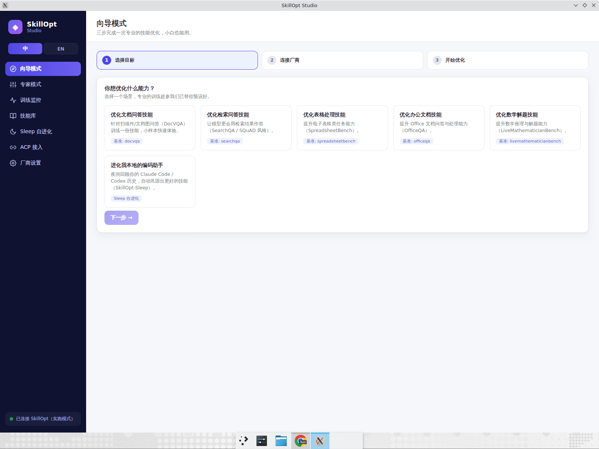

### 2. Wizard → live monitor, run completes
Pipeline advances rollout→gate, best held-out rises to **0.540**, exports
`best_skill.md`; "演示/完成" badges shown.
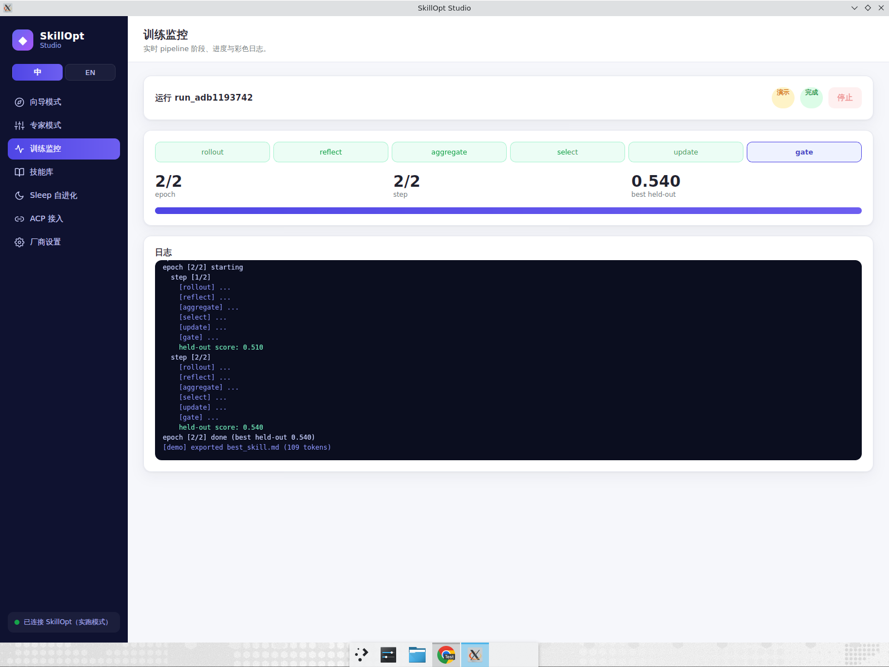

### 3. Skill library — score curve + native export panel
Detail panel shows the score curve (0.420 → 0.510) and a native export path
field (no browser `prompt()`).
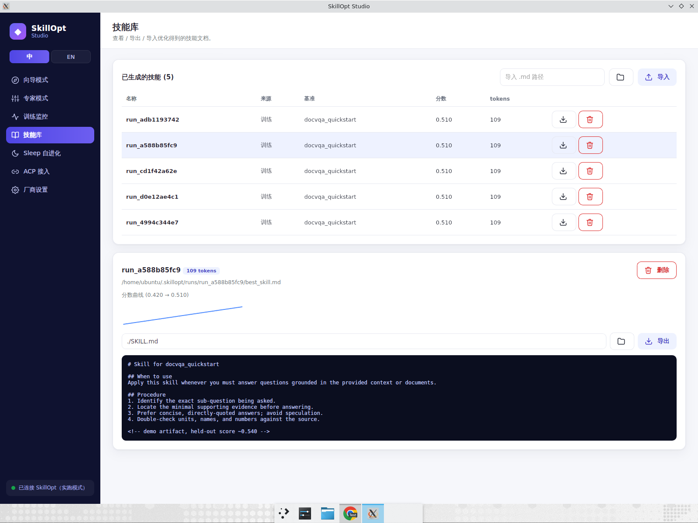

### 4. Delete via native confirm dialog
A native WebKit confirm dialog appears (not a silent action).
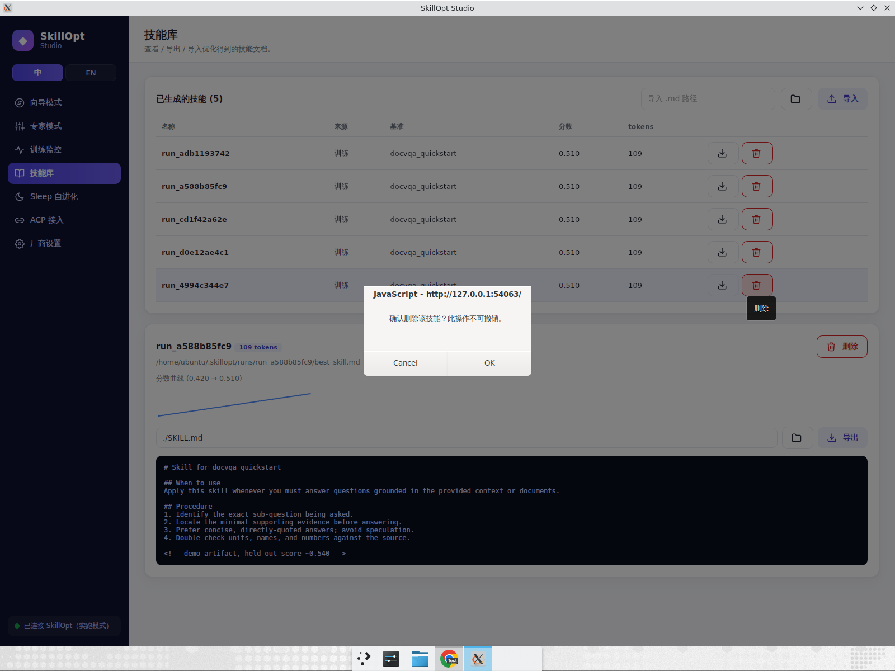

On OK the skill count drops 5 → 4 with a "已删除" toast.
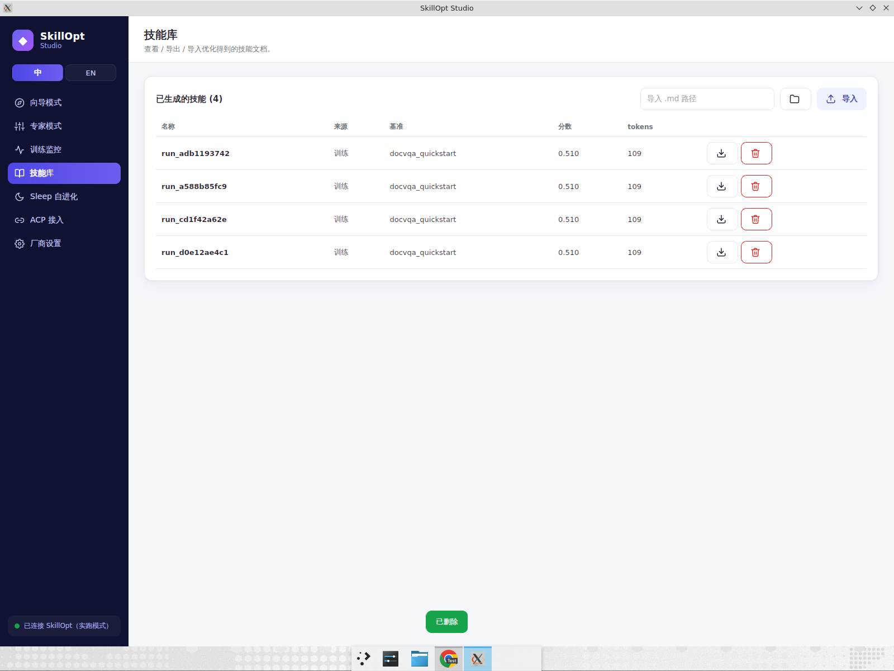

### 5. English UI
Nav, headers, table columns and status line all switch instantly.
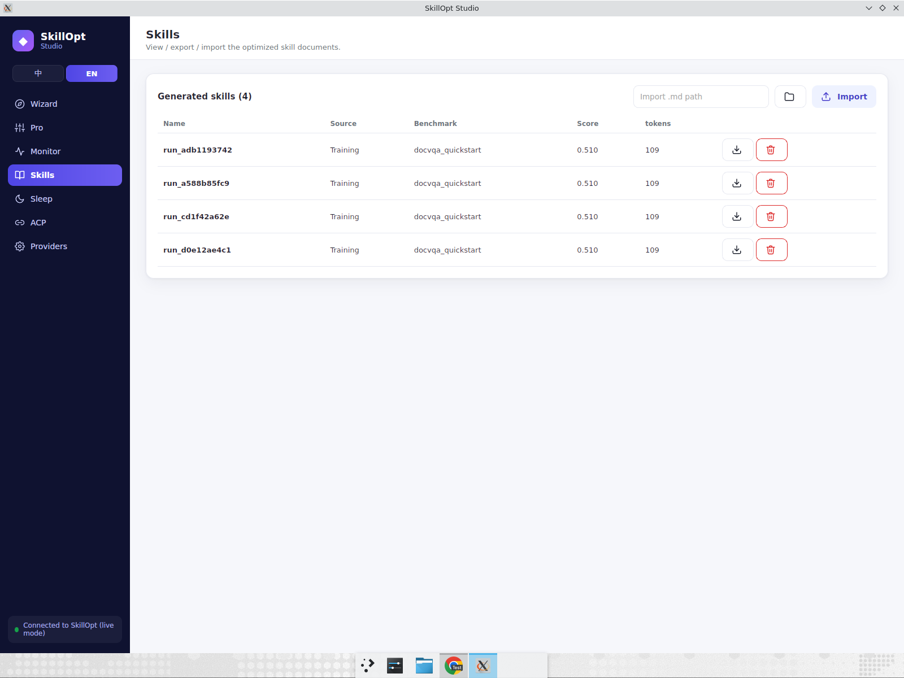

### 6. Authenticated provider probe (OpenAI)
A fake key produces a real authenticated probe result: **"reachable but key
rejected (401)"** — i.e. the app actually called the provider endpoint.
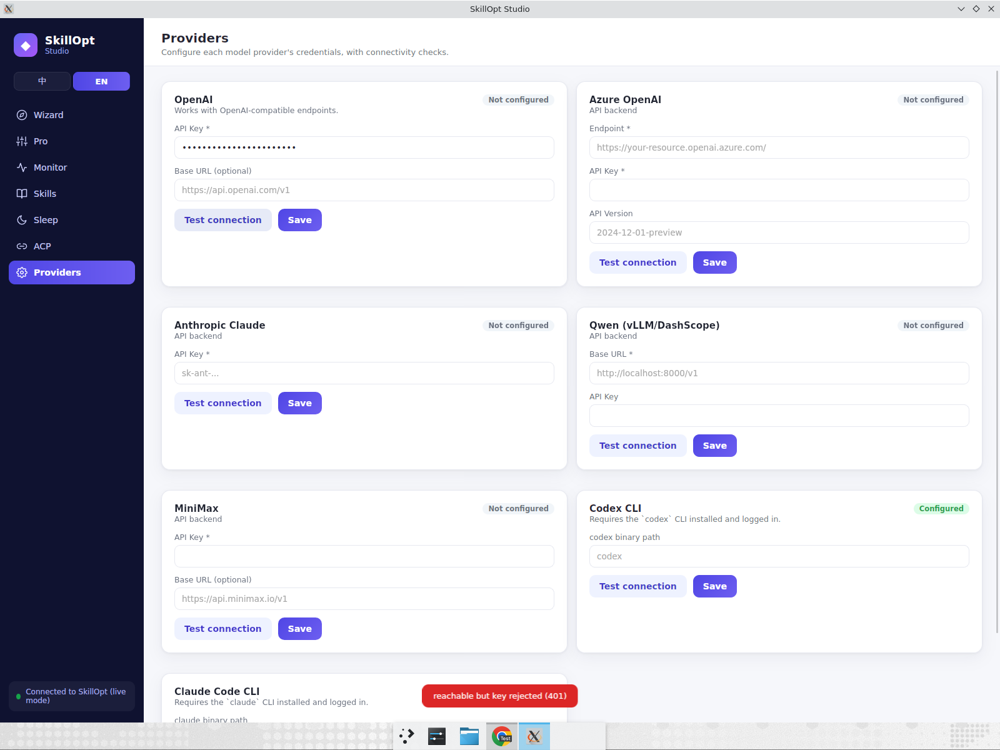

### 7. Local CLI provider probe (Codex)
`shutil.which`-based probe correctly reports **"codex not on PATH"**.
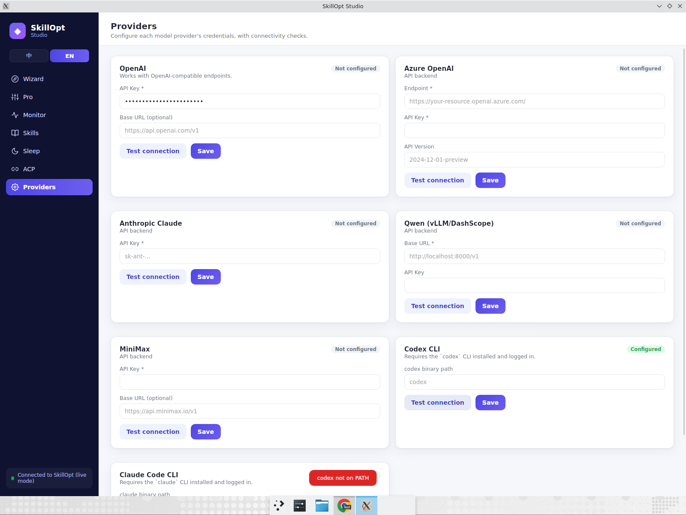

### 8. ACP agent registration
Installed badge, launch command, editor `agent_servers` config snippet, and the
optimize/sleep/skills/help command table.
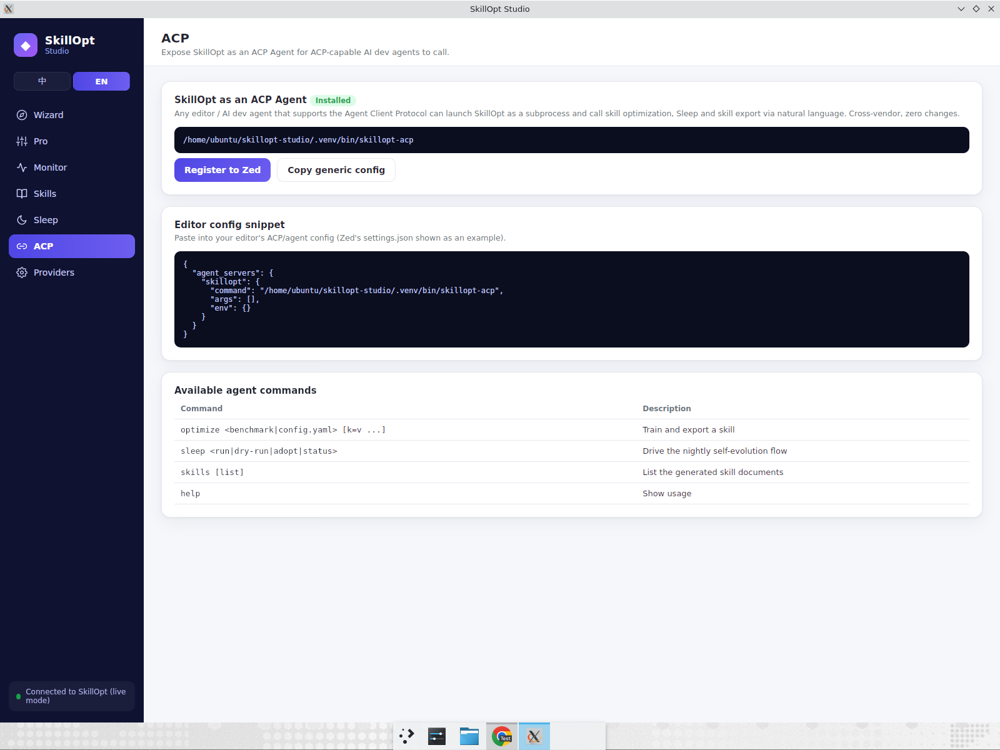

### 9. Offline Sleep nightly self-evolution
"Run a night" produces a real **"Passed gate"** nightly report (+1.000 gain),
an adopted staged edit, and a real on-disk staging directory.
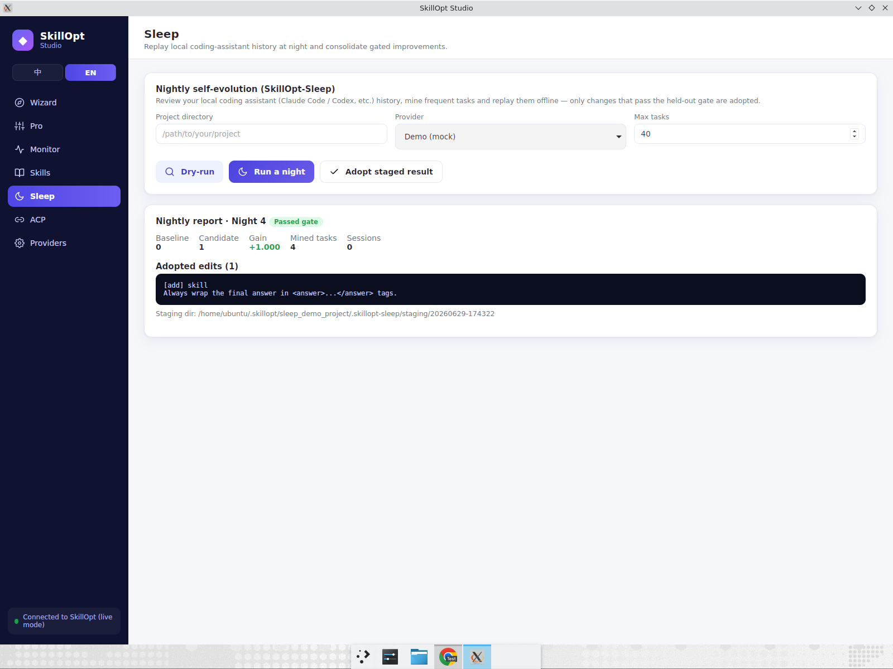

### 10. Back to Chinese
EN → 中 toggle re-renders all labels back to Chinese instantly.
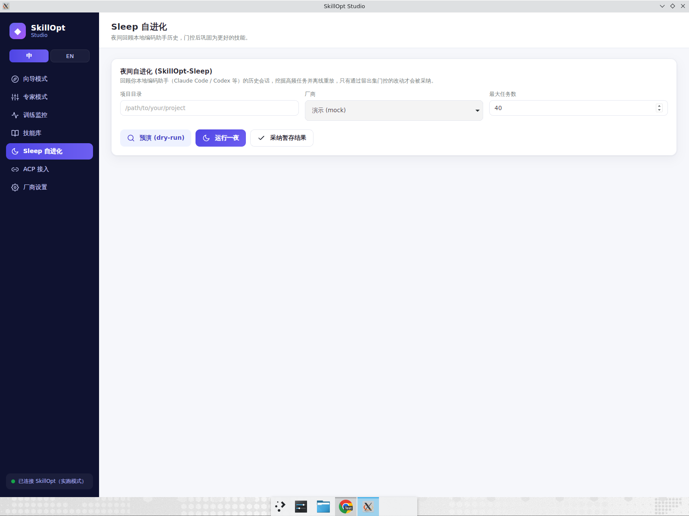

## Unit tests

`pytest -q` → **17 passed**.
