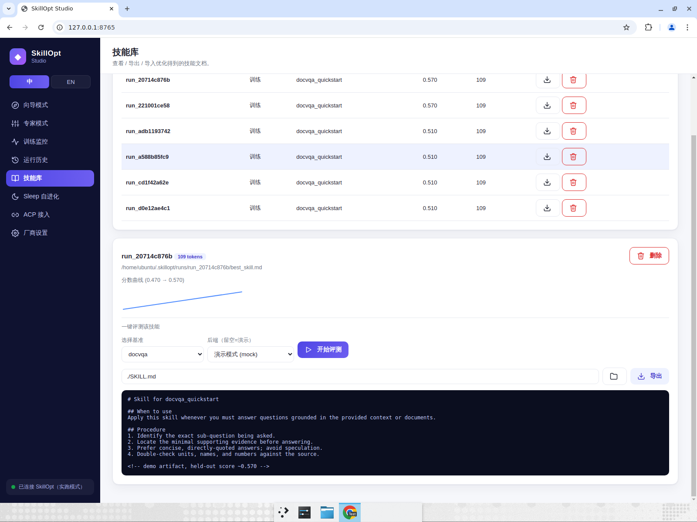
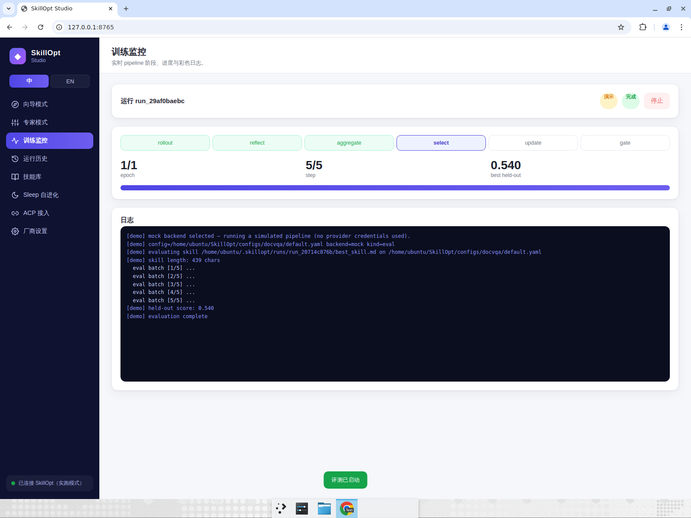

# 测试报告 — P1-7 技能库一键评测（演示模式修复）

## 背景 / Bug
此前在技能库点击「开始评测」时，留空后端（演示模式）仍会调用**真实** `eval_only`，
在缺少数据的演示环境上跑 `alfworld`，导致崩溃。同时基准下拉默认未能匹配技能记录的
`docvqa_quickstart`（预设名 vs benchmark 名不一致），默认落到 `alfworld`。

## 修复
- `services/training.py`：留空/`mock` 后端一律视为演示模式；`kind=="eval"` 走新增的
  `_run_mock_eval()`，模拟 held-out 评测（不启动真实 env-heavy CLI）。
- `web/js/skills.js`：新增 `defaultBench()` 把技能记录的 benchmark（如
  `docvqa_quickstart`）规范化到真实 benchmark（`docvqa`）；评测请求发送 `mock: !backend`。
- `server.py` / `pro.js`：`EvalBody` 增加 `mock` 字段并透传。

## 验证（演示模式，无需任何 API Key）
1. 技能库 → 打开 `run_20714c876b` → 一键评测面板：基准默认正确为 **docvqa**，后端为 **演示模式 (mock)**。

2. 点击「开始评测」→ 跳转训练监控，模拟 5 个 eval batch → **held-out score: 0.540**，
   状态「演示完成」，**无崩溃**。

## 自动化测试
- `tests/test_api.py::test_eval_demo_simulates_score_without_real_evaluator`
- `tests/test_api.py::test_blank_backend_forces_mock_even_when_real_available`
- 全套：`ruff check` 通过；`pytest -q` **24 passed**。
