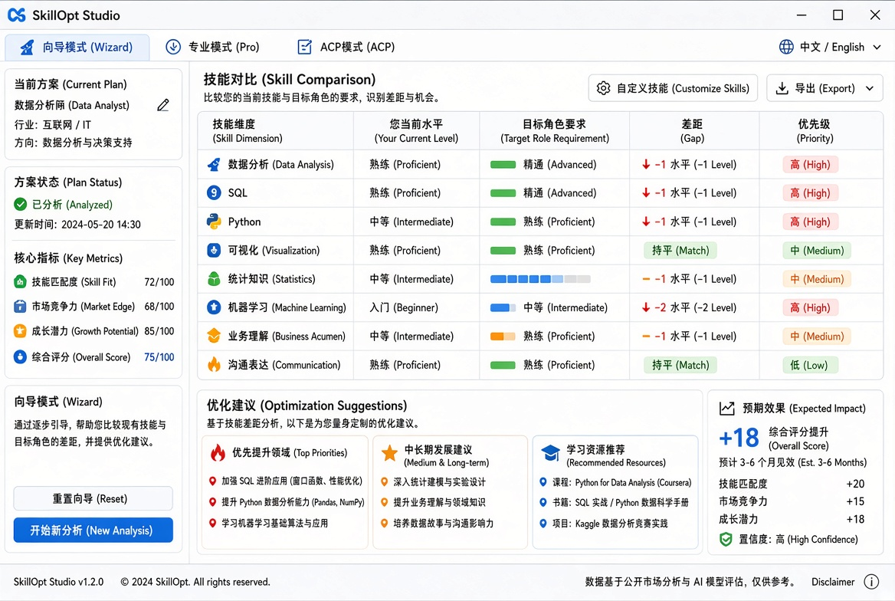

# SkillOpt Studio 文档

SkillOpt Studio 是跨厂商技能优化桌面应用，支持 Wizard / Pro / ACP 三种模式，中英双语，跨平台。

## 界面预览

## 三种模式

- **Wizard**: 引导式技能差距分析
- **Pro**: 专业对比与优化建议
- **ACP**: 高级配置模式

## 主要功能

- 技能维度对比
- 差距分析与优先级
- 学习资源推荐
- 预期效果评估
