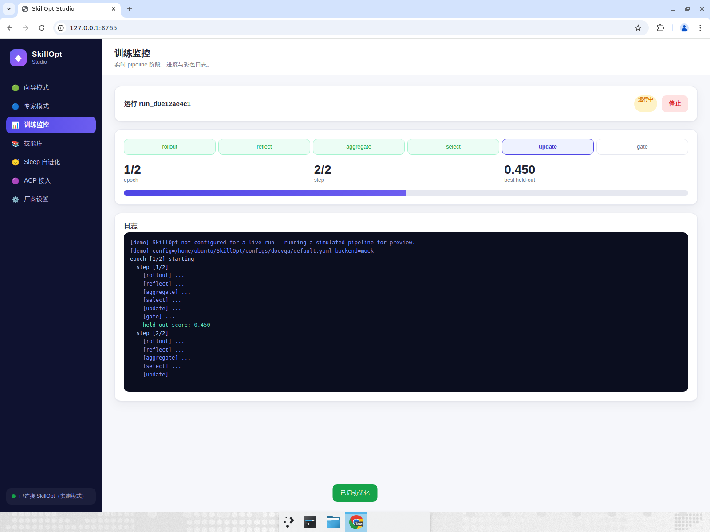
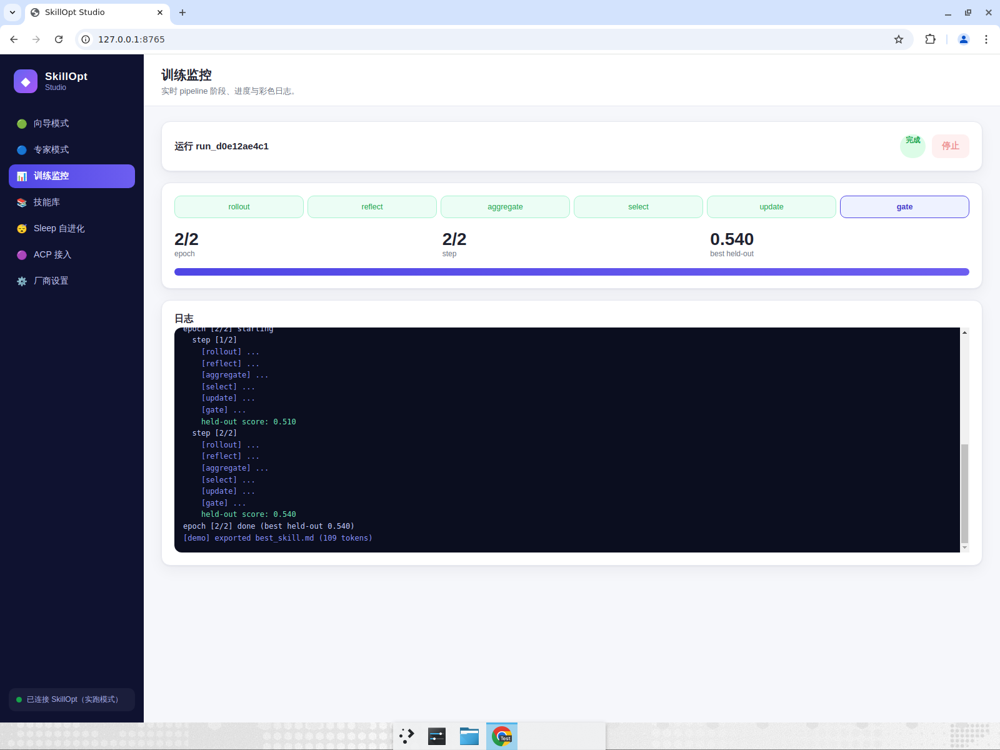
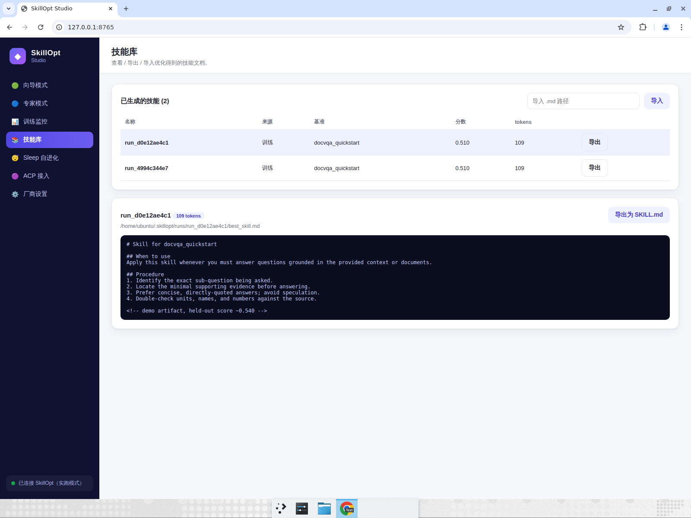
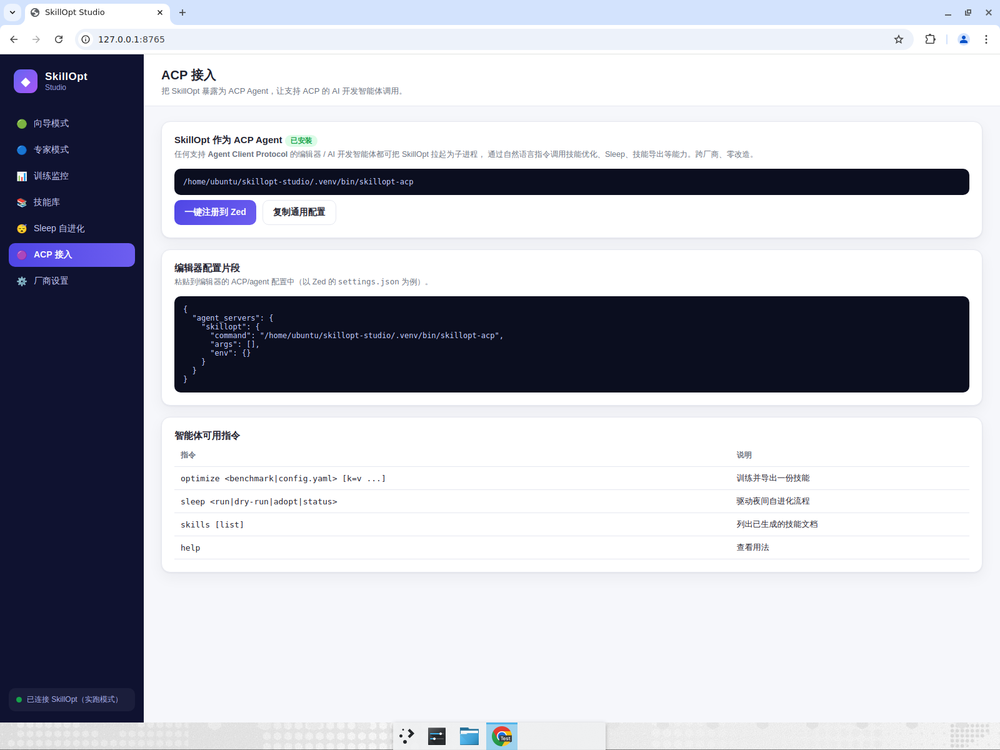

# SkillOpt Studio — E2E Test Report

**App under test:** `skillopt-studio --no-window --port 8765` (local), opened in Chrome at `http://127.0.0.1:8765/`, demo mode (no provider credentials).
**Result:** ✅ All 4 tests passed.

## Fix validated by this run
The live training monitor previously relied on a WebSocket that silently failed when uvicorn had no WS library installed, so the UI never updated. Changed the monitor to **HTTP polling** (`GET /api/train/{id}/log?offset=N`) and added `websockets` to dependencies. This run confirms the monitor now updates live.

## Results

| # | Test | Result |
|---|------|--------|
| 1 | Beginner wizard launches a full optimization | ✅ passed |
| 2 | Monitor advances through all 6 stages and completes | ✅ passed |
| 3 | Skill library shows the produced artifact | ✅ passed |
| 4 | ACP integration surface is exposed | ✅ passed |

## Evidence

| Live monitor (running) | Completed run |
|---|---|
|  |  |
| Stages advancing, score 0.45→0.48, log streaming | 完成 badge, all stages done, 0.540, exported best_skill.md (109 tokens) |

| Skill library detail | ACP surface |
|---|---|
|  |  |
| SKILL.md content, 109 tokens, export button | skillopt-acp cmd, agent_servers config, optimize/sleep/skills/help |

## Assertions verified
- **Test 1:** DocVQA preset selectable → 下一步 enabled; demo provider default; 开始优化 toast "已启动优化" and auto-navigate to 训练监控.
- **Test 2:** 6 stage chips highlight in sequence (rollout→gate); progress bar 0→100%; epoch 2/2, step 2/2; best held-out climbed 0.450→0.480→0.510→0.540; log ended with `[demo] exported best_skill.md (109 tokens)`; badge flipped 运行中→完成; stop button disabled.
- **Test 3:** 技能库 lists run (来源=训练, 基准=docvqa_quickstart, score 0.510, tokens 109); detail panel renders `# Skill for docvqa_quickstart` markdown with When to use / Procedure sections and file path.
- **Test 4:** ACP 接入 shows 已安装 status, launch command `skillopt-acp`, `agent_servers.skillopt` config snippet, and commands table (optimize, sleep, skills, help).

## Already-verified (shell, not recorded)
- `pytest -q`: 10 passed.
- ACP stdio: piped initialize + session/new + prompt("skills") → valid JSON-RPC, protocolVersion=1, session/update streaming.
